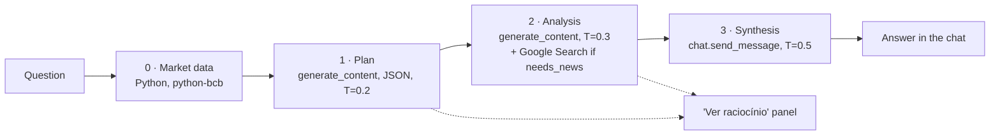

# Design decisions

This document explains the main decisions behind FinBot and **why** each one was made. It is based on the project's development spec (the plan written before the code, kept outside the repository) and checked against the current code in `src/`. Where the code moved away from the spec, see [improvements.md](improvements.md). For installation and usage, see the [project README](../README.md).

Interface strings and prompts are quoted in Portuguese, as they appear in the app, with a short translation in parentheses.

## 1. The problem: an investment copilot

FinBot is the final project of the *Transformer Architecture and LLMs* course. The assignment asks for a Streamlit chat on Gemini with conversation memory and **no naive calls**: one reasoning strategy among Self-Consistency (A), Chain-of-Thought (B) and Tree of Thoughts (C), with intermediate reasoning that does not clutter the screen.

We chose personal investment questions ("where should I put R$ 20,000 from my savings account?") because a naive answer is visibly worse than a reasoned one there:

- **They need math.** Comparing a CDB, an LCI and the savings account means computing returns after income tax, which depends on the holding period (22.5% up to 180 days, down to 15% after 720 days), and comparing them with the CDI.
- **They depend on the person.** Risk profile, emergency fund, horizon and liquidity change the right answer.
- **They depend on the moment.** Today's Selic rate, inflation and the last Copom decision matter.
- **They follow a natural sequence:** understand the goal → gather data → compute → check suitability → recommend.

*Alternatives considered:* a generic finance Q&A bot (mostly definitions, little reasoning) and a budgeting assistant (math, but little need for market data or multi-step reasoning).

**Limits, on purpose.** FinBot is educational. It talks about asset classes and criteria ("a post-fixed bond with daily liquidity"), never "buy X", because naming products as buy orders is regulated investment advice in Brazil. It does not execute orders, connect to brokers or store data between sessions: the profile and the conversation live only in the browser session, so no personal financial data is kept on a server. The disclaimer is enforced in three places (sidebar caption, system instruction and the end of every answer), because any one of them alone is easy to miss or to dilute over a long conversation.

## 2. Why Chain-of-Thought

| Criterion | **B — Chain-of-Thought (chosen)** | A — Self-Consistency | C — Tree of Thoughts |
| --- | --- | --- | --- |
| LLM calls per question | **3** | 5+ samples + aggregation | 6 to 10 (branches, evaluation, synthesis) |
| Fit with the problem | **A financial decision is a natural sequence of steps** | Voting needs short, comparable answers; paragraphs of advice cannot be compared by majority | Useful to compare strategies, but spends many calls even on simple questions |
| Rate-limit risk (HTTP 429) | **Low** | Medium | High |
| Web searches per question | **At most 1** | One per sample | One per branch |
| Explainable in a 5-minute video | **Yes: one function per stage** | Yes | Hard |

**It mirrors how the decision is made.** A planner follows a checklist, not a vote. With CoT, the plan stage *writes* the checklist, the analysis stage *executes* it, and the synthesis stage *communicates* the result.

**Self-Consistency fixes the wrong errors.** The mistakes that matter here (made-up rates, the wrong tax bracket, ignoring the emergency fund) are systematic: sampling five times repeats them. Feeding the model real data and an explicit checklist fixes them.

**Tree of Thoughts is overkill.** Most questions are narrow ("CDB or LCI for 2 years?"); exploring branches would restate the options the plan already lists, at 2 to 3 times the cost.

**The quota is a real constraint.** On the free tier, requests per minute and per day are limited, and excess requests return `429 RESOURCE_EXHAUSTED`. Search grounding has its own, smaller quota (zero on the free tier for Gemini 3.x models, as we found during development; see [Gemini API rate limits](https://aistudio.google.com/docs/rate-limits), checked November 2026). Strategies that multiply calls and searches would hit those limits during a demo.

### Why three calls instead of one "think step by step" prompt

Each stage needs something a single prompt cannot give:

- **A decision the code can read.** The plan returns `needs_news` as a JSON boolean, so the code turns web search on or off. In a single prompt that decision would be buried in text.
- **Different temperatures:** 0.2 for the plan, 0.3 for the analysis (stable math), 0.5 for the answer (more fluent prose).
- **Clean memory.** Only the final answer enters the chat history (see section 4).
- **Reasoning shown apart from the answer.** Each stage's output is already a separate value for the "Ver raciocínio" (show reasoning) panel.

*Cost accepted:* each question uses three calls instead of one and takes longer (three loading messages).

## 3. The pipeline

`run_turn` in `src/reasoning.py` runs every question:

| Stage | Call | Input | Output |
| --- | --- | --- | --- |
| 0. Market data | Python, no LLM (`get_indicators`, cached 1 h) | — | Selic, CDI, 12-month IPCA with dates |
| 1. Plan | `generate_content`, stateless, `response_schema=Plan` | Question, profile, last 3 turns | Intent, related goal, `needs_news`, up to 3 searches, 3–6 steps |
| 2. Analysis | `generate_content`, stateless; search tool only if `needs_news` | Plan, profile, rates, tax table, last 3 turns | After-tax math, suitability checks, risks, news summary, sources |
| 3. Synthesis | `chat.send_message`, the only call with memory | Question + analysis | Final answer ending with the disclaimer |

**The plan is JSON validated by Pydantic.** Structured output makes the fields predictable, and Pydantic enforces what the schema cannot always express (3–6 steps, at most 3 searches). If the JSON is invalid, `default_plan` takes over with three generic steps and no search, instead of failing the turn or spending another call: a malformed plan is rarely transient, and a generic checklist is good enough for the analysis.

**Search is decided by the code, not the model.** The search tool is attached only when the plan says news is needed: grounding is slower, has its own quota, and rates already come from Python. If the grounded call fails (quota, blocked tool, network), the analysis runs again without search and the answer carries the note *"sem notícias recentes"* (no recent news). That call is not retried, because a grounding quota error lasts the whole day. If the model had search but returned no sources, the same note is added, so the user is not misled.

**The analysis never invents rates.** Its prompt contains the Central Bank rates with their reference dates and the regressive income tax table, and tells the model to say so and compare in relative terms if rates are unavailable. It is marked as internal: no greetings, straight to the numbers.

**The synthesis temperature is set when the chat is created.** In the SDK, a config passed to `send_message` replaces the whole chat config, including the system instruction with the profile. Setting temperature 0.5 once in `create_chat` avoids losing the rules.

**The same rules in every stage.** Plan, analysis and chat all get the same `SYSTEM_INSTRUCTION` with the profile and the four suitability rules. Otherwise the analysis could recommend equities for a 1-year goal and the answer would contradict its own input.

**Prompts in Portuguese, code in English.** The prompt language steers the answer language: English prompts with "answer in Portuguese" drift into English terms. Portuguese prompts also carry the vocabulary users expect (*reserva de emergência*, *liquidez diária*). The profile's field names are in English (`emergency_fund`), so the system instruction maps them and forbids showing them to the user.

## 4. Memory: only the answer enters the chat

This is the central design decision.

**Stages 1 and 2 are stateless.** Every `chat.send_message` becomes a turn in the history. Running all three stages through the chat would add two internal prompts per question ("build a plan…", "analyze…"), triple the history size and confuse later turns. So the plan and the analysis use `generate_content`, which has no memory, and receive context explicitly: the profile through the system instruction and the last 6 history items (3 turns) as text. Six is a balance: enough for follow-ups about the last questions, while keeping the prompts bounded (each history item already includes a previous analysis). The synthesis still sees the full conversation.

**The synthesis message carries the analysis.** What enters memory is "question + analysis" and "final answer". So a follow-up like "and if I need the money in one year?" reuses the R$ 20,000 and the computed returns without re-running earlier stages. The screen shows only the original question, kept separately in `st.session_state.messages` with each answer's plan, analysis and sources, so old answers keep their reasoning panels after a rerun.

**Profile or key changes keep the conversation.** The system instruction (with the profile) and the API key are fixed when a chat is created. When either changes, `src/app.py` recreates the chat with `history=chat.get_history()`: the new rules apply from the next answer and the memory survives. Recreating a chat is local, with no API call, so doing it on every profile edit costs nothing.

## 5. Market data and suitability rules

**Rates come from Python, not from the model.** `gemini-3.1-flash-lite` has a knowledge cutoff of January 2025, so it would guess today's rates. `src/market.py` reads the Central Bank's SGS with `python-bcb`: Selic target (series 432), annualized CDI (4389) and 12-month IPCA (13522), each with its own last value and date, because their frequencies differ (IPCA is monthly and published with a lag, so the query looks back 90 days). The query ends today because series 432 is filled ahead with future dates for the current target.

**Search is not used for rates, and function calling is not used at all.** The API does not combine search grounding and function calling in one request, so the Central Bank data is fetched before the call and injected into the prompt. Search is reserved for news and context.

**Only successes are cached.** The fetch is cached for 1 hour with `st.cache_data`, which does not cache exceptions; the wrapper catches errors and returns `{}`. Catching inside the cached function would store the failure for an hour.

**Suitability rules**, in the system instruction of every stage:

1. Without an emergency fund of 6 months of living costs, the priority is building it in a daily-liquidity asset.
2. A product above the profile's risk is never the main suggestion; at most a warning.
3. The goal's horizon sets the required liquidity: under 2 years excludes equities as the base.
4. Returns are always compared after income tax, using the regressive table; LCI and LCA are tax-exempt.

They encode the most common mistakes of beginner investors, and they make answers checkable: the reasoning panel shows the analysis applying each one.

## 6. Robustness

Every failure has a defined behavior, and none crashes the app or shows a stack trace.

| Failure | Behavior |
| --- | --- |
| Rate limit (429), server error (5xx), connection error or timeout | One call plus 3 retries, waiting 2 s, 4 s and 8 s (`tenacity`); then a friendly message |
| Invalid key (400/401/403) | No retry; *"Chave inválida ou sem permissão"* (invalid key or no permission) |
| Invalid plan JSON | Generic plan, the turn continues |
| Central Bank unavailable | Sidebar warning; answer with *"análise sem taxas atualizadas"* (analysis without current rates) |
| Search fails or finds nothing | Analysis without search; note *"sem notícias recentes"* |
| Unexpected error | Short message on screen, traceback only in the terminal |

**Only transient errors are retried.** Retrying a bad key wastes time; retrying a 429 or a dropped connection often works. Retrying `send_message` is safe because the SDK records a turn only after a valid answer. Connection errors are checked for both `httpx` and `httpx2`, because the SDK can use either as transport.

**A failed turn is not stored.** The question enters `st.session_state.messages` only after the answer succeeds, so the screen and the model's memory never disagree.

**The API key is optional on the server.** If `GEMINI_API_KEY` is set (`.env` or Streamlit Secrets), the app uses it and shows no key field. If not, the sidebar asks for the user's own key, kept only in that browser session, and the chat stays locked until one is entered. This lets the same code run locally with a developer key and publicly with each visitor paying for their own questions.

**Two resets.** "Nova conversa" (new conversation) recreates the chat without history, which is what actually clears the model's context, and keeps the profile so the user does not refill it. "Limpar perfil" (clear profile) also resets the profile and goals. Clearing widget keys from `st.session_state` was not enough: the browser keeps each widget's last value and sends it back on the next rerun, so old values returned. The profile widgets' keys carry a generation number, and "Limpar perfil" increments it, which creates fresh widgets.

## 7. Interface

- **Reasoning one click away.** The plan, the analysis and the sources sit in a collapsed "Ver raciocínio" panel under each answer. The chat stays clean (as the assignment requires), and the reasoning can be shown in the video.
- **One loading message per stage:** *"Montando o plano de análise…"*, *"Analisando perfil, mercado e notícias…"*, *"Escrevendo a recomendação…"* (building the plan, analyzing, writing the recommendation). Three calls take a few seconds; naming each stage makes the wait understandable.
- **Native Streamlit first.** Theme in `.streamlit/config.toml` (light and dark, navy and emerald), Material icons, `st.segmented_control` for the risk profile and `st.pills` for clickable question suggestions on an empty chat. Native widgets do not break on Streamlit updates the way custom CSS does.
- **One custom component, where nothing native fits.** Money fields use a small inline component (`src/ui/money_input.py`) with a fixed comma: digits fill in from the right (`123456` becomes `1.234,56`), an empty field shows a `0,00` placeholder, and values apply 300 ms after typing stops, without Enter. `st.number_input` kept the zeros while typing and only applied on Enter, which led to wrong values.
- **Market rates and an emergency fund badge in the sidebar**, so the user sees the same numbers the analysis uses and whether the 6-month rule is met.
